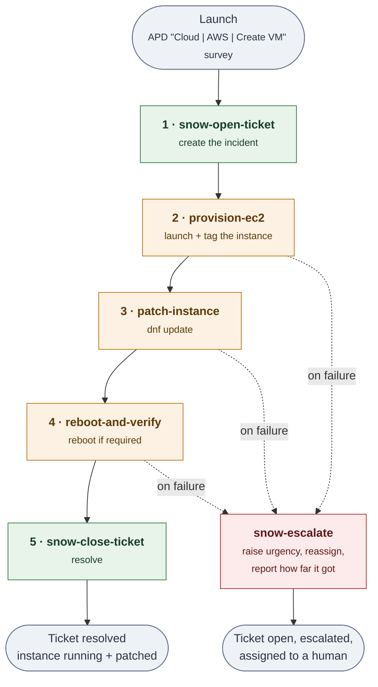

# aap-snow

An AAP + ServiceNow demo: a workflow provisions an EC2 instance, opens a ServiceNow
ticket carrying the real instance facts, patches the instance, and updates and resolves
the ticket as it goes.

**Start here: [docs/mvp/](docs/mvp/README.md)** — goal, phased plan, and known risks.
**Running it in AAP: [docs/mvp/aap-setup.md](docs/mvp/aap-setup.md)**.

## The workflow



Every path ends in exactly one ticket-writing node, so the ticket always reaches a defined
state. Green nodes write to ServiceNow, amber nodes act on AWS. The detailed version
showing which artifacts flow along each edge is in
[docs/mvp/architecture.md](docs/mvp/architecture.md).

## Building it in AAP

Full walkthrough with screenshots-worth-of-detail in
[docs/mvp/aap-setup.md](docs/mvp/aap-setup.md). This is the reference version.

### Credentials

| Credential | Type | Supplies |
|---|---|---|
| ServiceNow | **custom** — see [setup §4b](docs/mvp/aap-setup.md) | `SN_HOST`, `SN_USERNAME`, `SN_PASSWORD`, `SN_TIMEOUT` |
| AWS | built-in *Amazon Web Services* | access key + secret key |
| Machine | built-in *Machine* | the SSH key for the EC2 keypair |

Reuse APD's Machine credential if you have the cloud stack deployed — its key already
matches the keypair. Its username is not `ec2-user`, which does not matter: the
playbooks set the login user from `create_vm_remote_user`, as APD's own inventory does.

### Job templates

Common to all: **Inventory** any containing `localhost` (stock *Demo Inventory* is
fine), **Execution Environment** one carrying `servicenow.itsm`, and
**Variables → Prompt on launch ticked** — without that last one the workflow will not
save.

| Template | Playbook | Credentials |
|---|---|---|
| `snow-open-ticket` | `playbooks/snow_open_ticket.yml` | ServiceNow |
| `provision-ec2` | `playbooks/provision_ec2.yml` | ServiceNow **+ AWS** |
| `patch-instance` | `playbooks/patch_instance.yml` | ServiceNow **+ Machine** |
| `reboot-and-verify` | `playbooks/reboot_and_verify.yml` | ServiceNow **+ Machine** |
| `snow-close-ticket` | `playbooks/snow_close_ticket.yml` | ServiceNow |
| `snow-escalate` | `playbooks/snow_escalate.yml` | ServiceNow |

`provision-ec2` additionally needs `amazon.aws` and `boto3` in its execution
environment. Do not tick *Privilege escalation* on any of them — `patch-instance`
declares `become` on the tasks that need it.

Two more templates that are **not** workflow nodes:

| Template | Playbook | Credentials | Purpose |
|---|---|---|---|
| `test-servicenow` | `playbooks/test_servicenow.yml` | ServiceNow | Connectivity check — run this first |
| `teardown` | `playbooks/teardown.yml` | AWS | Terminate the instance, by hand after a run |

### Survey

Put the APD **"Cloud | AWS | Create VM"** survey on the **workflow**, not on the
individual templates. Survey answers become launch-time extra vars for the whole
workflow, so every node sees them; attaching it to a template makes that node prompt
again and its defaults can shadow the workflow's values.

Only `create_vm_vm_name` has no default — everything else falls back to
[`vars/demo.yml`](vars/demo.yml).

### Nodes and edges

| From | Edge | To |
|---|---|---|
| *(start)* | — | `snow-open-ticket` |
| `snow-open-ticket` | on success | `provision-ec2` |
| `provision-ec2` | on success | `patch-instance` |
| `provision-ec2` | **on failure** | `snow-escalate` |
| `patch-instance` | on success | `reboot-and-verify` |
| `patch-instance` | **on failure** | `snow-escalate` |
| `reboot-and-verify` | on success | `snow-close-ticket` |
| `reboot-and-verify` | **on failure** | `snow-escalate` |

`snow-open-ticket` gets no failure edge: if it fails there is no ticket to escalate
onto, and the failure is visible in the job output. Optionally add one from
`snow-close-ticket` to `snow-escalate` — the escalation note already has a branch for
"stopped while closing the ticket".

Never put `snow_sys_id` in the survey or in any node's extra vars. Node 2 onward must
receive it as an artifact; supplying it by hand defeats the thing the demo proves.

## Status

| Phase | | |
|---|---|---|
| [0](docs/mvp/phase-0-environment.md) | Environment bring-up | not started |
| [1](docs/mvp/phase-1-open-ticket.md) | Open the ticket from a playbook | **working** — verified in AAP against a live PDI |
| [2](docs/mvp/phase-2-provision-ec2.md) | Provision EC2, write facts to the ticket | **working** — verified in AAP, two-node workflow proven |
| [3](docs/mvp/phase-3-patch-instance.md) | Patch, report results to the ticket | **working** — verified in AAP |
| [4](docs/mvp/phase-4-workflow.md) | Wire into one AAP workflow | **working** — verified in AAP |
| [5](docs/mvp/phase-5-failure-and-teardown.md) | Failure path and cost control | **implemented**, not yet run |

## Layout

```
playbooks/     one playbook per workflow node
  test_servicenow.yml   standalone AAP <-> ServiceNow connectivity check
roles/
  snow_ticket/ every ServiceNow write goes through here
vars/demo.yml  shared demo defaults (overridable by survey / -e)
inventory/     localhost, for local testing
collections/   requirements.yml (installed collections are gitignored)
docs/mvp/      the plan
```

## Quick start

```bash
ansible-galaxy collection install -r collections/requirements.yml -p ./collections

export SN_HOST='https://devXXXXXX.service-now.com'
export SN_USERNAME='aap.integration'
export SN_PASSWORD='…'

ansible-playbook playbooks/snow_open_ticket.yml \
  -e create_vm_vm_name=web-demo-01 \
  -e create_vm_aws_region=us-east-2 \
  -e vm_blueprint=al2023
```

Variable names match the Ansible Product Demos **"Cloud | AWS | Create VM"** survey, so
that survey drives these job templates unchanged.

Credentials are read from the environment by the `servicenow.itsm` modules. In AAP they
come from the ServiceNow credential instead — nothing in this repo reads a secrets file,
and nothing should.

## Checks

```bash
ansible-lint playbooks/ roles/
yamllint playbooks/ roles/ inventory/
```
