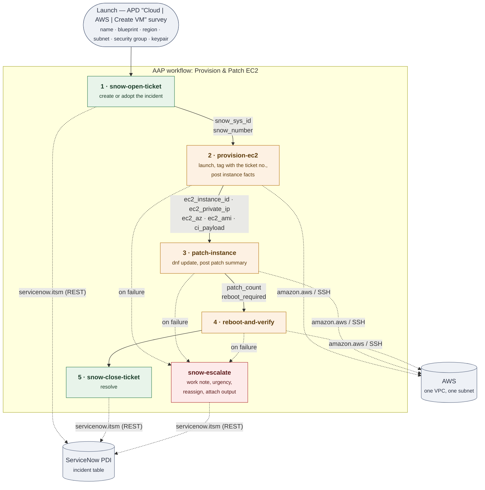

# Architecture

[← Index](README.md) · [Phase 0 →](phase-0-environment.md)

## Workflow shape

Edge labels are the `set_stats` artifacts each node publishes to the ones after it.



Survey answers are launch-time extra vars for the whole workflow, so `create_vm_vm_name`,
`create_vm_aws_instance_size` and `create_vm_aws_region` reach every node without being republished. Only
*discovered* values travel as artifacts — which is why the edge labels above contain no
survey fields.

**Every path terminates in exactly one ticket-writing node:** success at node 5
(resolved), failure at `snow-escalate` (open and escalated). The graph encodes the
outcome, so no node needs to branch on an "did it work?" variable — see
[Phase 4](phase-4-workflow.md#why-node-5-is-not-wired-always) for the earlier design that
got this wrong.

## The two mechanics this demo proves

**Artifact passing.** Node [1] publishes `snow_sys_id` via `ansible.builtin.set_stats`;
node [2] publishes the EC2 facts the same way. AAP injects artifacts into every downstream
node as extra vars, so each node knows both *which ticket* and *which instance* it is
working on — with no external state store, no database, no file on disk.

**Ticket-first ordering.** The ticket is opened *before* provisioning, then enriched with
real facts immediately after. The ticket still carries hostname/instance size as intended,
but this ordering also means a provisioning *failure* has a ticket to be reported on. If
the ticket were created after the instance, a failed launch would leave no record at all,
which is the one scenario ITSM people care most about.

## Design decisions that keep the roadmap cheap

Each costs ~20 minutes during the MVP and saves a refactor later. Do all three.

### 1. Make node [1] skippable

The workflow should accept an *optional* inbound `snow_sys_id`. If one is supplied,
node [1] skips creation and simply adopts the existing ticket:

```yaml
- name: Create incident
  servicenow.itsm.incident:
    # ...
  register: ticket
  when: snow_sys_id is not defined

- name: Publish ticket identity (created or inherited)
  ansible.builtin.set_stats:
    data:
      snow_sys_id: "{{ snow_sys_id | default(ticket.record.sys_id) }}"
      snow_number: "{{ snow_number | default(ticket.record.number) }}"
    per_host: false
```

That single `when:` is the entire hook [Phase 6](phase-6-servicenow-trigger.md) needs. When
ServiceNow drives the workflow, it passes the sys_id of the RITM/change it already created,
and every downstream node updates *that* ticket without any other change.

### 2. Never touch the ticket outside the `snow_ticket` role

Every note/resolve/escalate call goes through `roles/snow_ticket`.
[Phase 6](phase-6-servicenow-trigger.md) changes the ticket *type* (incident →
`sc_req_item` or `change_request`), and that becomes a one-file change instead of a
repo-wide search.

### 3. Build the CI fact dict now, even though nothing consumes it

In `provision_ec2.yml`, assemble the instance facts in CMDB field shape and publish them as
an artifact. [Phase 7](phase-7-cmdb.md) then only has to add the API call:

```yaml
- name: Assemble CMDB-shaped facts (not yet written to the CMDB)
  ansible.builtin.set_stats:
    data:
      ci_payload:
        name: "{{ create_vm_vm_name }}"
        ip_address: "{{ ec2_facts.private_ip_address | default('') }}"
        object_id: "{{ ec2_facts.instance_id }}"           # AWS instance ID
        cpu_count: "{{ ec2_facts.cpu_options.core_count | default('') }}"
        environment: "{{ create_vm_vm_environment }}"
        os: "Linux"
    per_host: false
```

Use `default('')` here, **not** `default(omit)`. `omit` is only meaningful as a module
*parameter* value; inside a `set_stats` data structure it serialises as the literal
placeholder string `__omit_place_holder__…` and would be carried into the CMDB in
Phase 7.

Tagging the instance with `snow_incident` (already in
[Phase 2](phase-2-provision-ec2.md)) is the fourth half of this — it gives Phase 7 a
correlation key between AWS and the CMDB.

## Proposed repo layout

```
aap-snow/
├── docs/mvp/                       # this documentation set
├── collections/requirements.yml    # servicenow.itsm, amazon.aws, ansible.posix (pinned)
├── playbooks/
│   ├── snow_open_ticket.yml
│   ├── provision_ec2.yml
│   ├── patch_instance.yml
│   ├── reboot_and_verify.yml
│   ├── snow_close_ticket.yml
│   ├── snow_escalate.yml
│   └── teardown.yml
├── roles/
│   └── snow_ticket/                # note / resolve / escalate tasks, reused everywhere
└── setup/
    └── controller.yml              # ansible.controller config-as-code (optional)
```

Defining the job templates, survey, and workflow with the `ansible.controller` collection
is optional, but it makes the demo rebuildable on a fresh AAP instance — worth it if this
gets handed to anyone else.

---

[← Index](README.md) · [Phase 0 →](phase-0-environment.md)
